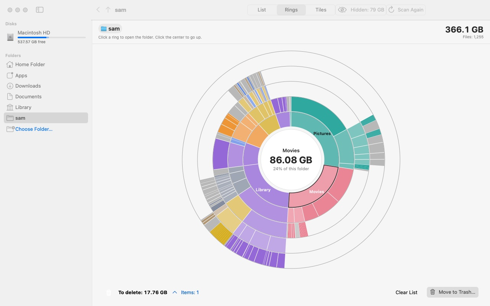
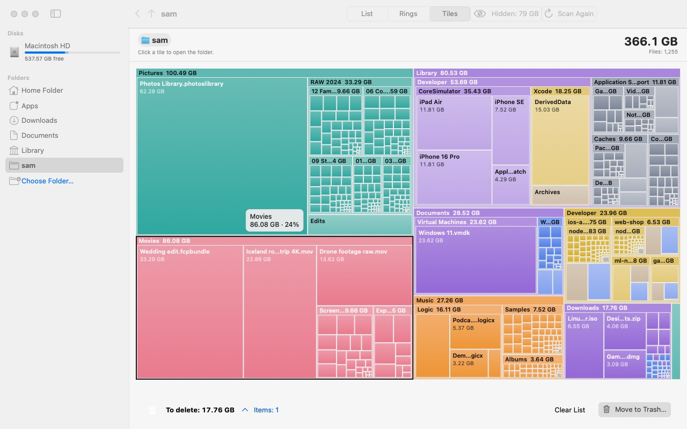

# Orbit

**Free disk space analyzer for macOS.** See at a glance what fills your disk — as rings or tiles —
collect the junk and send it to the Trash. Every feature, no limits, no account, no telemetry.

🌐 **Website: [inkstatim.dev/orbit](https://inkstatim.dev/orbit/)** · [English](#install) · [Українською](#українською) · [По-русски](#по-русски)



<sub>Demo folder: names and sizes are made up.</sub>

## Install

**Easiest — one command, about a minute:**

1. Open **Terminal**: press **⌘ Space**, type `Terminal`, press **Enter**.
2. Paste this line (**⌘ V**) and press **Enter**:

   ```
   curl -fsSL https://raw.githubusercontent.com/inkstatim/orbit-releases/main/install.sh | bash
   ```

3. Done — Orbit downloads, installs to Applications and starts.

**Homebrew:**

```
brew install inkstatim/orbit/orbit
```

**Or download the DMG:** [Orbit.dmg](https://github.com/inkstatim/orbit-releases/releases/latest/download/Orbit.dmg) →
drag Orbit to Applications. On first launch macOS warns that it can't verify the developer: open
**System Settings → Privacy & Security → Open Anyway** (macOS 14: right-click Orbit → Open).

To see the whole disk, give Orbit **Full Disk Access** — without it macOS hides some folders (Mail, Messages,
other apps' data) and they end up in "hidden space". Orbit opens the right setting for you.
macOS 14 or later, Apple Silicon and Intel.

**Updates install themselves:** Orbit → Check for Updates… → Install and Relaunch. Permissions are kept.

## Features

- Fast scan of a whole disk or any folder — several folders are read in parallel, sizes match `du` to the byte
- **Rings:** folders as nested rings — hover to see the size, click to dive in, click the center to go up
- **Tiles:** the same as a treemap with nested folders
- Colors by content — video, music, photos, documents, archives, apps, code, system files — and a breakdown per folder
- Apps and libraries (.app, Photos Library…) count as one object
- **Hidden space:** what's used on the disk but not visible in folders — purgeable space, APFS system volumes,
  folders locked without Full Disk Access, local Time Machine snapshots
- **Cleanup tray:** drag files from the chart, the list or the Finder, check the total, delete in one go —
  to the Trash by default, so nothing is lost by mistake
- Reveal in Finder, open, copy path, drag files out to other apps
- 14 interface languages: English, Deutsch, Español, Français, Italiano, Nederlands, Polski, Português (Brasil),
  Türkçe, Українська, Русский, 日本語, 한국어, 简体中文 — follows your system language



## Privacy & safety

- Orbit only reads file names and sizes. Nothing leaves your Mac. No account, no analytics.
  Orbit goes online only to check this repository for updates (once a day) and when you send
  a problem report yourself (Report a Problem… — you see everything that will be sent;
  reports are kept for up to 90 days and used only to fix bugs).
- Nothing is deleted without your confirmation; by default files go to the Trash.
- Orbit is not notarized by Apple: that needs a paid developer certificate ($99/year).
  It is signed with its own certificate; the installer checks that signature before installing.
  The installer is a short script — [read it](install.sh) before running.

## ☕ Buy me a coffee

Orbit is free. If it saves you time, you can buy the developer a coffee in crypto.
**[☕ Donate with any crypto](https://nowpayments.io/donation/inkstatim)** — pay in any coin NOWPayments supports.

Or send directly to an address below. **Send only on the network shown** — a transfer on another network is lost.

| Coin | Network | Address |
|---|---|---|
| USDT | TRC-20 (Tron) | `TAWB59Ux6Zbtn1cgG5DhSXXYnP8xpYSW2U` |
| SOL | Solana | `8kn2UnorPSzKVNiDXSsUhLQxcN9PzBrGGC2CYD9oNswQ` |
| BTC | Bitcoin | `16eZYwKBSFA6bgRodD2qTMK3KBtUdwXooJ` |

Bugs: **Help menu → Report a Problem…**. Ideas and feature requests — Telegram [@akm_tims](https://t.me/akm_tims).

---

## Українською

**Orbit — безкоштовний аналізатор диска для macOS.** Показує кільцями або плитками, що займає місце,
допомагає зібрати непотріб і викинути його в Кошик. Без обмежень, без акаунта й аналітики. Інтерфейс українською.

**Встановлення за хвилину:** відкрийте «Термінал» (**⌘ Пробіл** → `Термінал` → **Enter**), вставте рядок і натисніть **Enter**:

```
curl -fsSL https://raw.githubusercontent.com/inkstatim/orbit-releases/main/install.sh | bash
```

Orbit сам завантажиться, встановиться в «Програми» й запуститься. Сайт: [inkstatim.dev/orbit](https://inkstatim.dev/orbit/).
Також: `brew install inkstatim/orbit/orbit` або [Orbit.dmg](https://github.com/inkstatim/orbit-releases/releases/latest/download/Orbit.dmg)
(тоді при першому запуску: «Системні параметри» → «Приватність і безпека» → «Усе одно відкрити»).
Щоб бачити весь диск, дайте Orbit «Повний доступ до диска».

**На каву ☕** — якщо Orbit знадобився, [задонатити будь-якою криптовалютою](https://nowpayments.io/donation/inkstatim) або адреси вище, у розділі [Buy me a coffee](#-buy-me-a-coffee).
Ідеї та помилки — у Telegram [@akm_tims](https://t.me/akm_tims).

## По-русски

**Orbit — бесплатный анализатор диска для macOS.** Показывает кольцами или плитками, что занимает место,
помогает собрать ненужное и выбросить в Корзину. Без ограничений, без аккаунта и аналитики.

**Установка за минуту:** откройте «Терминал» (**⌘ Пробел** → `Терминал` → **Enter**), вставьте строку и нажмите **Enter**:

```
curl -fsSL https://raw.githubusercontent.com/inkstatim/orbit-releases/main/install.sh | bash
```

Orbit сам скачается, установится в «Программы» и запустится. Сайт: [inkstatim.dev/orbit](https://inkstatim.dev/orbit/).
Ещё варианты: `brew install inkstatim/orbit/orbit` или [Orbit.dmg](https://github.com/inkstatim/orbit-releases/releases/latest/download/Orbit.dmg)
(тогда при первом запуске: «Системные настройки» → «Конфиденциальность и безопасность» → «Всё равно открыть»).
Чтобы видеть весь диск, дайте Orbit «Полный доступ к диску».

**На кофе ☕** — если Orbit пригодился, [задонатить любой криптовалютой](https://nowpayments.io/donation/inkstatim) или адреса выше, в разделе [Buy me a coffee](#-buy-me-a-coffee).
Идеи и ошибки — в Telegram [@akm_tims](https://t.me/akm_tims).

---

## For the maintainer (по-русски)

`appcast.json` — манифест обновлений: Orbit раз в сутки и по «Проверить обновления…» читает его
с `raw.githubusercontent.com` и предлагает новую версию, если `build` больше установленного.
Ссылка `url` должна вести в этот репозиторий — другие адреса приложение не откроет.

`install.sh` — установка одной командой: скачивает `releases/latest/download/Orbit.dmg`, проверяет подпись,
копирует Orbit в «Программы» и запускает.

Выпуск версии — см. `orbit/CLAUDE.md`, «Выпуск»: релиз с тегом `v<версия>` и **обоими** DMG
(`Orbit-<версия>.dmg` и `Orbit.dmg`), затем `version`, `build`, `url`, `notes` в `appcast.json`.
Картинки в `assets/` — из `Orbit --snapshot demo <папка>` (вымышленная папка, не снимок экрана).
